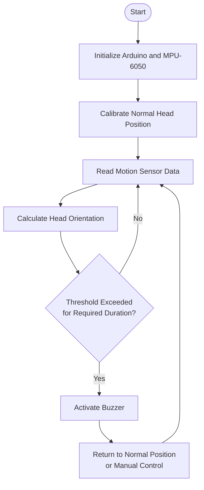

# 🚨 SADAR — Smart Anti-Drowsiness and Alertness Response


**SADAR (Smart Anti-Drowsiness and Alertness Response)** is an Arduino-based smart helmet prototype designed to detect potential signs of microsleep in motorcycle riders through abnormal head movements and provide an automatic audible warning.

Developed by **Team FOUR ONE** as part of the 2025 OPSI research project, SADAR combines motion sensing, embedded programming, and an automatic alert system to explore a practical approach to motorcycle rider safety.

> ⚠️ **Disclaimer:** SADAR is a research prototype, not a certified safety device. It does not directly detect sleep or guarantee the prevention of accidents.

---

## 📌 Overview

Microsleep is a brief episode of involuntary sleep that can cause a driver to lose awareness and control of a vehicle. SADAR explores the use of head movement as an indicator of potential drowsiness.

The system uses an **MPU-6050 accelerometer and gyroscope** to monitor head orientation. An Arduino Uno processes the sensor readings and activates a buzzer when the detected head angle exceeds a predefined threshold for a specified duration.

The prototype is designed to operate independently without requiring an internet connection or an external monitoring application.

## ✨ Features

- 📐 **Head Tilt Detection** — Monitors changes in head orientation using the MPU-6050.
- 📊 **Real-Time Motion Monitoring** — Processes accelerometer and gyroscope readings.
- 🎯 **Initial Calibration** — Establishes a reference position for the user's normal head orientation.
- ⏱️ **Threshold-Based Detection** — Identifies potentially abnormal head positions sustained over time.
- 🚨 **Automatic Audible Alert** — Activates a buzzer when the detection conditions are met.
- 🔘 **Manual Alert Control** — Includes a button for manual buzzer control.
- 🔋 **Battery-Powered Operation** — Designed for standalone use without an internet connection.
- 🪖 **Helmet Integration** — Integrates the electronic components into a motorcycle helmet prototype.

## 🧰 Hardware Components

| Component | Purpose |
|---|---|
| Arduino Uno | Main microcontroller for sensor processing and system control |
| MPU-6050 | Measures acceleration and angular velocity |
| Buzzer / speaker | Provides an audible warning |
| Push button | Provides manual alert control |
| 2 × 18650 batteries | Supplies power to the system |
| Jumper wires and PCB | Connects the electronic components |
| SNI-standard helmet | Serves as the prototype's physical platform |

## ⚙️ System Architecture

The system follows a sensor-processing-alert workflow.

1. **Initialization:** The Arduino initializes the MPU-6050 and alert components.
2. **Calibration:** The system records the user's initial head position as a reference.
3. **Motion Tracking:** The sensor continuously measures head movement and orientation.
4. **Threshold Evaluation:** The Arduino evaluates the detected head angle and how long the abnormal position persists.
5. **Alert Activation:** If the configured detection conditions are satisfied, the buzzer is activated.
6. **Return to Monitoring:** The system resumes monitoring and waits for subsequent detection events.

### System Workflow



## 🔌 Pin Configuration

The following pin assignments are based on the prototype's existing project documentation and README.

| Component | Arduino Uno Pin |
|---|---|
| MPU-6050 SDA | A4 |
| MPU-6050 SCL | A5 |
| Buzzer | Digital Pin 12 |
| Push Button | Digital Pin 7 |

**Note:** Verify the actual wiring against the source code and physical prototype before assembling the circuit. The MPU-6050 communicates with the Arduino Uno through I²C.

## 🧠 Detection Logic

SADAR uses head orientation as an indicator of potential microsleep.

The research prototype uses the following detection parameters:

| Parameter | Configuration |
|---|---|
| Forward head tilt | Approximately greater than 40° |
| Sustained abnormal position | At least 2 seconds |
| Sensor calibration | Establishes the initial head position |
| Alert output | Audible buzzer |

When the head remains beyond the configured threshold for the required duration, the system classifies the movement as a potential microsleep indicator and triggers an audible warning.

The exact threshold and timing behavior depend on the implemented firmware and sensor calibration.

**Important limitation:** Head tilt alone cannot confirm microsleep. Normal movements, such as looking down, may trigger false alarms.

## 🛠️ Software and Development

- **Programming language:** C++
- **Development environment:** Arduino IDE
- **Communication protocol:** I²C
- **Motion sensor:** MPU-6050

### Prerequisites

Before running the project, prepare:

- Arduino Uno
- MPU-6050 module
- Buzzer and push button
- Arduino IDE
- A compatible MPU-6050 library

The Arduino `Wire` library is used for I²C communication and is included with the Arduino platform.

## 🚀 Getting Started

### 1. Clone the repository

Replace `YOUR_USERNAME` with the actual GitHub username or organization that owns the repository.

```bash
git clone https://github.com/YOUR_USERNAME/SADAR.git
cd SADAR
```

### 2. Open the project

Open the Arduino source file (`.ino`) in Arduino IDE.

### 3. Install the required library

Install a compatible MPU-6050 library through the Arduino IDE Library Manager. Ensure that the library API matches the headers used by the source code.

### 4. Connect the hardware

Wire the Arduino Uno, MPU-6050, buzzer, and push button according to the pin configuration.

### 5. Configure the board

In Arduino IDE:

1. Select the appropriate Arduino Uno board.
2. Select the connected serial port.
3. Verify the wiring and power configuration.

### 6. Upload and test

Upload the firmware and keep the helmet stationary during initial calibration. Test the detection behavior using controlled head movements while the prototype is not being used on public roads.

## 📈 Research and Experimental Results

According to the **2025 OPSI research report**, the SADAR prototype was evaluated using different head positions to assess its ability to distinguish normal and abnormal movements.

### Head Position Detection

| Test Condition | Actual Head Angle | Reported Detection Result | Reported Accuracy |
|---|---:|---|---:|
| Normal upright | 0°–10° | No alert | 100% |
| Slight forward tilt | Approximately 20° | No alert | 95% |
| Deep forward tilt | Approximately 45° | Alert | 98% |
| Sudden forward tilt | Approximately 50° | Alert | 99% |

These figures are the results reported in the research document under its test conditions. They should not be interpreted as a clinically validated microsleep detection accuracy or a guarantee of real-world road safety.

### Battery Performance

The research report describes a power configuration using two 18650 batteries connected in series, with a nominal combined voltage of approximately 7.4 V and a reported capacity of 2,500 mAh.

| Operating Condition | Reported Current | Estimated Runtime |
|---|---:|---:|
| Idle: Arduino and sensor active | 75 mA | Approximately 33.3 hours |
| Buzzer continuously active | 110 mA | Approximately 22.7 hours |
| Mixed operation: alarm active 10% of the time | 78.5 mA | Approximately 31.8 hours |

Battery runtime is an estimate from the reported tests and may vary depending on battery condition, component consumption, and actual operating conditions.

## ⚠️ Limitations

Although the prototype demonstrated promising results during its reported tests, several limitations remain:

- **Potential false positives:** Normal head movements can resemble abnormal head tilts.
- **Limited detection indicators:** The system relies primarily on head orientation rather than directly measuring sleep or physiological indicators.
- **Ergonomics:** The battery pack and electronic components may increase helmet weight.
- **Charging convenience:** The reported prototype requires battery removal for charging.
- **Real-world validation:** Additional controlled testing is needed to evaluate performance across different users and riding conditions.

SADAR should be considered an experimental warning system rather than a replacement for adequate rest, safe riding practices, or certified protective equipment.

## 🔭 Future Improvements

Potential directions for further development include:

- Integrating a heart-rate or eye-monitoring sensor to explore additional indicators of drowsiness.
- Improving motion filtering to reduce false detections.
- Optimizing the electronics and battery placement to improve comfort.
- Adding a USB Type-C charging system with an appropriate battery management circuit.
- Recording sensor readings and detection events for further analysis.
- Exploring wireless connectivity for optional monitoring and data visualization.

These are proposed improvements, not features confirmed to be implemented in the current prototype.

## 👥 Team FOUR ONE

This project was developed as part of the 2025 OPSI research project at SMA Negeri 1 Pasuruan, East Java, Indonesia.

- **Muhammad Irwan Wafi** — Team Leader
- **Fatra Sidik Abdillah** — Team Member

### Acknowledgements

We would like to thank SMA Negeri 1 Pasuruan, the school's Robotics extracurricular program, and the alumni who provided equipment, facilities, and support during the research and prototype development process.

## 📄 Research Documentation

This repository documents the embedded system prototype developed alongside the research project:

**SADAR (Smart Anti-Drowsiness and Alertness Response): An Arduino-Based Smart Helmet Innovation for Microsleep Prevention Among Motorcycle Riders.**

The original research report was prepared for OPSI 2025 by Team FOUR ONE.

## 🤝 Contributions

Suggestions and improvements are welcome.

If you would like to contribute:

1. Fork the repository.
2. Create a feature branch.
3. Commit your changes.
4. Open a pull request describing your improvements.

## 📜 License

If this repository is distributed under the MIT License, include a `LICENSE` file containing the appropriate license text. Otherwise, replace this section with the license that actually applies to the project.

---

*Built with curiosity, engineering, and a commitment to exploring safer riding technology.* 🪖
